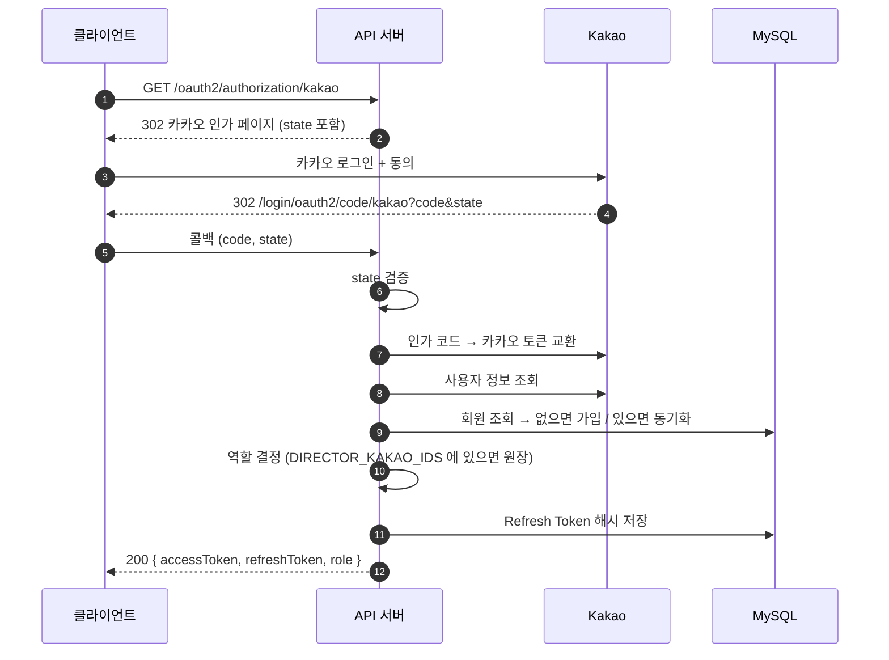
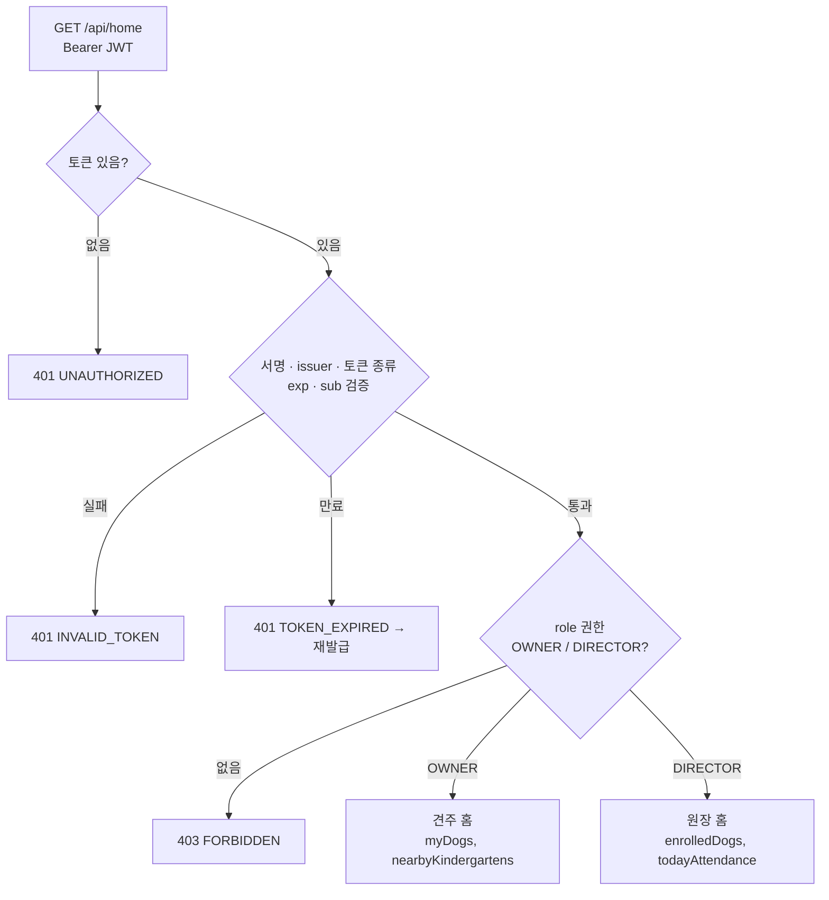

# puppy-kindergarten-api

반려견 유치원(견주 ↔ 원장) 인증/권한 API

카카오 로그인 → 자체 JWT 발급 → 역할(견주/원장)별 홈 분기

1. [전체 흐름](#1-전체-흐름)
2. [기술 선택 근거](#2-기술-선택-근거)
3. [실행 방법](#3-실행-방법)
4. [환경변수](#4-환경변수)
5. [API 명세](#5-api-명세)
6. [인증 정책](#6-인증-정책)
7. [테스트와 검증](#7-테스트와-검증)
8. [Git 전략](#8-git-전략)
9. [LLM 활용 내역](#9-llm-활용-내역)
10. [실서비스 적용 시 고려사항](#10-실서비스-적용-시-고려사항)

---

## 1. 전체 흐름

### 로그인 → JWT 발급



### JWT 검증 → 역할 분기



---

## 2. 기술 선택 근거

| 구분 | 사용 |
|---|---|
| 언어 / 빌드 | Java 17, Gradle 8.14 |
| 프레임워크 | Spring Boot 3.3.13, Spring Security 6.3 (OAuth2 Client + Resource Server) |
| DB | MySQL 8.0, Spring Data JPA |
| JWT | nimbus-jose-jwt (HS256) |
| 테스트 | JUnit 5, MockMvc, Testcontainers (MySQL 8.0) |

- **OAuth2 Client**: 인가 요청, `state` 검증, 토큰 교환을 직접 구현하지 않고 검증된 구현에 맡김. 직접 짠 건 회원 연결과 성공/실패 처리뿐
- **Resource Server**: Bearer 검증 필터를 직접 만들지 않음. 커스텀 필터의 흔한 실수(예외 누락, 필터 순서)를 피함
- **nimbus-jose-jwt**: Resource Server 에 이미 포함. 발급과 검증을 추가 의존성 없이 한 라이브러리로 통일
- **HS256**: 발급·검증 주체가 같은 단일 서버라 대칭키로 충분
- **Refresh Token 해시 저장**: DB 가 유출돼도 저장된 값으로 재발급 불가
- **역할별 `HomeProvider`**: `if (role == ...)` 분기 대신 역할마다 구현체 하나. 역할 추가 시 구현체만 추가, 빠뜨리면 기동 실패
- **Testcontainers**: 테스트도 운영과 같은 MySQL 8.0 에서 실행. 처음엔 H2 를 썼지만, MySQL 에서만 나는 교착 상태 버그를 H2 가 놓쳐서 전환

---

## 3. 실행 방법

**카카오 콘솔 설정** ([developers.kakao.com](https://developers.kakao.com))
1. [앱] > [플랫폼 키] > [REST API 키]: REST API 키·클라이언트 시크릿 확인, 리다이렉트 URI `http://localhost:8080/login/oauth2/code/kakao` 등록
2. [카카오 로그인] > [사용 설정] ON
3. [카카오 로그인] > [동의항목] 닉네임 설정

**실행**
```bash
cp .env.example .env          # 값 입력 (JWT_SECRET 은 openssl rand -base64 32)
docker compose up -d          # MySQL (127.0.0.1:3306)
./gradlew bootRun
```

**확인**
1. 브라우저에서 `http://localhost:8080/oauth2/authorization/kakao` → 로그인 → 응답의 `accessToken` 복사
2. `curl -H "Authorization: Bearer <accessToken>" http://localhost:8080/api/home`

**원장으로 확인**: `/api/users/me` 의 `kakaoId` 를 `.env` 의 `DIRECTOR_KAKAO_IDS` 에 넣고 재시작 → 재로그인 또는 재발급

**테스트**: `./gradlew test` (Docker 필요. MySQL 컨테이너를 자동으로 띄웠다 지움. 로컬 MySQL·`.env`·카카오 키 불필요)

---

## 4. 환경변수

시크릿은 환경변수로만 주입. `.env` 는 git 제외, 저장소에는 [.env.example](.env.example) 만 있음

| 이름 | 필수 | 기본값 | 설명 |
|---|---|---|---|
| `DB_USERNAME` / `DB_PASSWORD` | O | | MySQL 계정 |
| `DB_ROOT_PASSWORD` | O | | MySQL root 비밀번호 (docker-compose) |
| `DB_HOST` / `DB_PORT` / `DB_NAME` | | `localhost` / `3306` / `puppy_kindergarten` | |
| `KAKAO_CLIENT_ID` | O | | 카카오 REST API 키 |
| `KAKAO_CLIENT_SECRET` | O | | 카카오 클라이언트 시크릿 |
| `JWT_SECRET` | O | | HS256 서명키 (Base64, 32바이트 이상) |
| `JWT_ACCESS_TTL` / `JWT_REFRESH_TTL` | | `15m` / `14d` | 토큰 유효 시간 |
| `DIRECTOR_KAKAO_IDS` | | | 원장 카카오 회원번호 (쉼표 구분) |
| `KAKAO_CONNECT_TIMEOUT` / `KAKAO_READ_TIMEOUT` | | `3s` / `5s` | 카카오 호출 제한 시간 |

필수 값이 없거나 `JWT_SECRET` 이 짧으면 기동 실패

---

## 5. API 명세

| 메서드 | 경로 | 인증 | 설명 |
|---|---|---|---|
| GET | `/oauth2/authorization/kakao` | - | 카카오 로그인 시작 |
| GET | `/login/oauth2/code/kakao` | - | 카카오 콜백. 가입/로그인 후 JWT 발급 |
| POST | `/api/auth/reissue` | Refresh | 토큰 재발급 |
| POST | `/api/auth/logout` | Refresh | 로그아웃 (204) |
| GET | `/api/users/me` | Bearer | 내 정보 |
| GET | `/api/home` | Bearer | 역할별 홈 |

**로그인 응답**
```json
{ "tokenType": "Bearer", "accessToken": "...", "accessTokenExpiresIn": 900,
  "refreshToken": "...", "userId": 1, "nickname": "초코아빠", "role": "OWNER" }
```

**재발급 / 로그아웃 요청**: `{ "refreshToken": "..." }`

**홈 응답** (데이터는 더미)
```json
{ "role": "OWNER", "myDogs": [...], "nearbyKindergartens": [...] }
```
```json
{ "role": "DIRECTOR", "kindergartenName": "해피퍼피 유치원", "enrolledDogs": [...], "todayAttendance": 5 }
```

**에러**: 모두 `{ "code": "...", "message": "..." }` 형식

| HTTP | code | 상황 |
|---|---|---|
| 400 | `INVALID_REQUEST` | 요청 형식 오류 |
| 401 | `UNAUTHORIZED` | 토큰 없음 |
| 401 | `TOKEN_EXPIRED` | Access Token 만료 → 재발급 |
| 401 | `INVALID_TOKEN` | 위조, 형식 오류, 필수 클레임 누락, Refresh 를 Bearer 로 사용 |
| 401 | `INVALID_REFRESH_TOKEN` | Refresh 위조·만료·사용됨·로그아웃됨 |
| 401 | `KAKAO_LOGIN_FAILED` | 로그인 취소, state 불일치 등 |
| 403 | `FORBIDDEN` | 역할 없음 |
| 404 | `NOT_FOUND` | 토큰은 유효하나 회원 없음 |
| 500 | `INTERNAL_ERROR` | 서버 오류 (로그인 중 DB 오류 등) |
| 503 | `KAKAO_UNAVAILABLE` | 카카오 연결 실패·응답 지연 |

---

## 6. 인증 정책

**토큰**

| | Access | Refresh |
|---|---|---|
| 유효 시간 | 15분 | 14일 |
| 클레임 | `sub`, `role`, `token_type`, `exp` 등 | `sub`, `token_type`, `exp` 등 |
| 서버 저장 | 안 함 | SHA-256 해시 |

- HS256 고정, `exp`·`sub` 필수, 만료 허용 오차 없음
- `token_type` 으로 구분해 Access ↔ Refresh 교차 사용 불가

**역할**
- 기본 견주. `DIRECTOR_KAKAO_IDS` 에 있는 카카오 회원번호만 원장 (사용자 선택 불가)
- 로그인·재발급 때마다 다시 계산
- `/home` 은 토큰의 역할, `/me` 는 DB 역할 기준. 역할이 바뀐 직후엔 둘이 다를 수 있음 (토큰 만료 후 일치)

**재발급**
- 교체 방식. 사용한 Refresh 는 즉시 폐기 (1회용)
- 같은 토큰으로 동시 요청 시 하나만 성공, 나머지 401. 다른 기기 토큰은 유지
- 재발급마다 Refresh 만료가 14일 연장 (절대 만료 없음)

**로그아웃**
- 제시한 Refresh 만 폐기. 다른 기기는 유지
- **Access Token 은 만료(최대 15분)까지 유효.** 서버에 저장하지 않아 즉시 차단하지 않음
- 이미 교체된 이전 Refresh 로 로그아웃하면 새 Refresh 는 남음. 최신 Refresh 로 요청해야 함

**기타**
- 카카오 호출 연결 3초·응답 5초 제한, 초과 시 503
- 같은 계정 동시 최초 로그인도 회원은 하나만 생성
- 세션 미사용(STATELESS), 만료된 Refresh 기록은 매일 정리
- 로그에 토큰·카카오 메시지 원문 미기록

---

## 7. 테스트와 검증

`./gradlew test` — 72개 통과 (Testcontainers MySQL 8.0)

| 대상 | 주요 검증 |
|---|---|
| 카카오 로그인 흐름 | 리다이렉트~JWT 발급~역할별 홈, state 위조 거부, 카카오 지연 503, DB 오류 500 |
| 카카오 응답 처리 | 회원번호 없음, 닉네임 미동의 대체, 50자 초과 자르기 |
| 회원 가입 | 중복 가입 방지(동시 요청 포함), 원장 지정, 역할 동기화 |
| JWT | 만료·위조·변조·`alg=none`·필수 클레임 누락 거부, 토큰 종류 교차 사용 거부 |
| 재발급·로그아웃 | 1회용, 동시 요청, 역할 재계산, 로그아웃 후 Access 유효 |
| 홈 | 역할별 응답, 401/403/404, 파라미터로 역할 변경 불가 |

카카오는 테스트 안에서 띄운 가짜 서버로 대체. 라인 커버리지 95.5%

**실제 카카오 환경 수동 검증** (최종 코드, 실제 카카오 계정 + 로컬 MySQL)

| 항목 | 결과 |
|---|---|
| 카카오 로그인 | 200, 견주로 로그인, Refresh 해시(64자) 저장 |
| 견주 홈 / 토큰 없음 / Refresh 를 Bearer 로 사용 | 200 / 401 `UNAUTHORIZED` / 401 `INVALID_TOKEN` |
| 원장 지정 후 재시작 | 기존 Access 는 만료 전까지 견주로 동작 (`/home`, `/me` 모두 OWNER) |
| 재발급 (만료 전 Access 헤더 동반) | 200, Refresh 교체, `role=DIRECTOR`, 원장 홈 200, `Cache-Control: no-store` |
| 사용한 Refresh 로 동시 3회 재발급 | 모두 401 |
| 새 Refresh 로 동시 4회 재발급 | 200 1건, 401 3건 (500 없음) |
| 로그아웃 | 204, 이후 재발급 401, Access 는 만료까지 200, 재호출도 204 |
| 서버 로그 | ERROR 0건, 토큰 문자열 노출 0건 |

---

## 8. Git 전략

`main ← epic/auth ← feature/*`, main 직접 push 금지, 기능 단위 PR

| PR | 내용 |
|---|---|
| #1 | 프로젝트 설정, MySQL, 환경변수 |
| #2 | 카카오 로그인, 가입, 역할 부여 |
| #3 | JWT 발급·검증 |
| #4 | 재발급·로그아웃 |
| #5 | 역할별 홈 |
| #6 | 문서 |
| #7 | 방어 보완 (필수 클레임, 로그인 중 오류, 카카오 타임아웃, 동시 가입, MySQL 교착 상태, DB 포트 제한), 테스트 MySQL 전환 |

---

## 9. LLM 활용 내역

Claude Code 로 설계·구현·테스트·리뷰·문서를 진행했고, Codex 로 전체 코드를 한 번 더 대조

| 작업 | 활용 | 검증 |
|---|---|---|
| 설계 | 진행 순서, PR 분할, 선택지 제안 | 직접 결정. 역할 부여는 제안(가입 후 선택 API) 대신 "서버 사전 지정", 로그아웃 정책도 직접 정함 |
| 구현·테스트 | 기능 단위 코드와 공격·오류 케이스 테스트 작성 | 매 변경 전체 테스트 실행, PR 단위로 검토 후 머지 |
| 리뷰 | 완료된 PR 에 LLM 리뷰 | 요구사항 기준으로 선별 반영 (19건 중 15건) |
| 문서 | README 초안 | 실제 동작·테스트와 대조 |

**그대로 쓰지 않은 사례**
- **재사용 감지 제거**: LLM 이 넣은 "재사용 시 전체 토큰 폐기" 가 재시도만으로 다른 기기까지 로그아웃시키는 문제 → 제거
- **만료 헤더 문제**: 재발급 요청에 만료된 Access 가 붙으면 401 로 막힘. 테스트가 이 경우를 안 다뤄 통과 중이었음 → 수정·테스트 추가
- **역할 재계산 누락**: 원장 목록에서 빠져도 재발급만으로 원장 권한 유지 → 재발급 시 재계산
- **만료 허용 오차**: 기본 60초 오차로 안내한 만료 시간과 실제가 다름 → 0초로
- **외부 검토 반영**: `exp` 없는 토큰 통과, 잘못된 `sub` 500, 로그인 중 DB 오류 형식, 카카오 타임아웃 → 재현 후 수정
- **Codex 변경**: 동시 최초 로그인 처리를 Claude Code 로 다시 검토한 뒤 반영
- **H2 테스트 통과를 믿지 않음**: 테스트를 실제 MySQL 로 돌리자, 같은 토큰으로 동시 재발급 시 교착 상태로 401 대신 500 이 나는 버그 발견 (H2 에선 통과) → 재시도로 수정하고 테스트를 Testcontainers MySQL 로 전환

**한계**
- 탈취된 Refresh 로 공격자가 먼저 재발급하면 공격자 토큰은 유지됨 (토큰 계열 추적 없음)
- 카카오 장애·DB 오류는 테스트에서 주입해 재현한 것이고, 실제 장애 상황에서 확인한 것은 아님

---

## 10. 실서비스 적용 시 고려사항

- **토큰 전달**: 지금은 콜백 응답 본문으로 반환(프론트 없는 과제 범위). 실서비스는 프론트로 리다이렉트 후 1회용 코드 교환, 또는 Refresh 를 HttpOnly·Secure 쿠키로 전달
- **원장 관리**: 환경변수 + 재시작 방식 → 관리자 API 또는 DB 관리로 전환
- **배포**: HTTPS, 프록시 뒤 `redirect_uri` 처리(forward headers), 프론트 도메인 CORS
- **DB**: `ddl-auto: update` → Flyway 등 마이그레이션
- **탈퇴**: 카카오 연결 끊기(unlink)와 회원 탈퇴 처리
- **보호**: 로그인·재발급 호출 횟수 제한, Refresh 토큰 계열 추적으로 탈취 대응
- **도메인**: 홈 더미 데이터 → 반려견·유치원·출석 실데이터 조회
