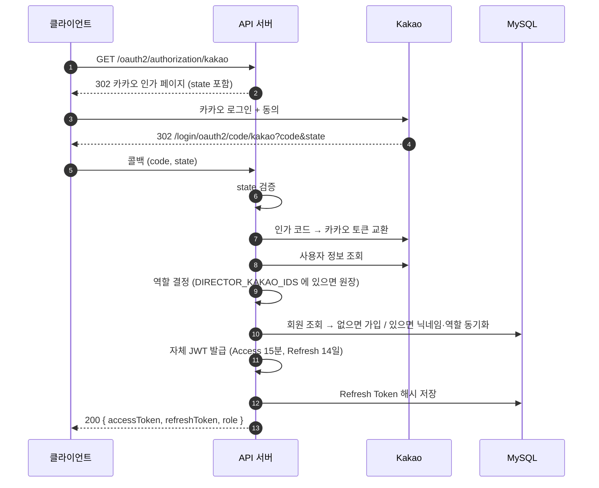
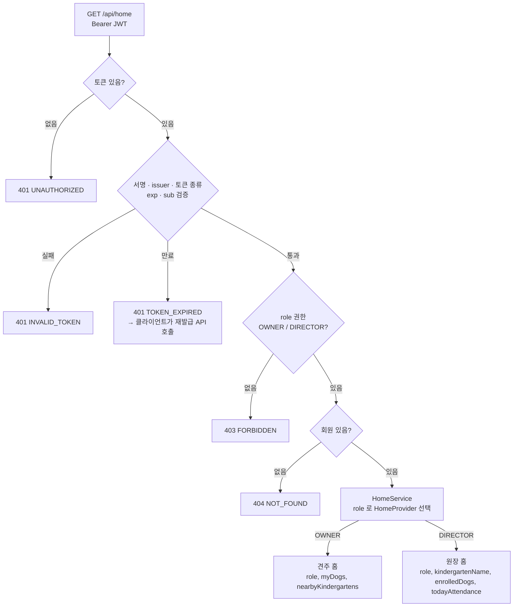

# puppy-kindergarten-api

반려견 유치원(견주 ↔ 원장) 인증/권한 API

카카오 로그인 → 자체 JWT 발급 → 역할(견주/원장)별 홈 분기

1. [전체 흐름](#1-전체-흐름)
2. [기술 선택 근거](#2-기술-선택-근거)
3. [실행 방법](#3-실행-방법)
4. [환경변수](#4-환경변수)
5. [API 명세](#5-api-명세)
6. [인증 정책](#6-인증-정책)
7. [테스트와 검증](#7-테스트와-검증)
8. [LLM 활용 내역](#8-llm-활용-내역)
9. [실서비스 적용 시 고려사항](#9-실서비스-적용-시-고려사항)

---

## 1. 전체 흐름

### 로그인 → JWT 발급



### JWT 검증 → 역할 분기



---

## 2. 기술 선택 근거

| 구분 | 사용 |
|---|---|
| 언어 / 빌드 | Java 17, Gradle 8.14 |
| 프레임워크 | Spring Boot 3.3.13, Spring Security 6.3 (OAuth2 Client + Resource Server) |
| DB | MySQL 8.0, Spring Data JPA |
| JWT | nimbus-jose-jwt (HS256) |
| 테스트 | JUnit 5, MockMvc, Testcontainers (MySQL 8.0) |

| 항목 | 선택 | 이유 |
|---|---|---|
| 카카오 로그인 | Spring Security OAuth2 Client | 인가 요청, `state` 검증, 토큰 교환, 사용자 정보 조회를 해당 라이브러리로 구현 |
| JWT | nimbus-jose-jwt | Spring Security 에 포함된 라이브러리로, 발급과 검증을 단일 라이브러리로 처리 |
| 서명 방식 | HS256 | 발급 서버와 검증 서버가 동일하여 단일 키로 서명·검증 |
| Refresh Token 저장 | MySQL 에 SHA-256 해시 | 원문을 저장하지 않으므로 DB 가 유출되어도 재발급에 사용 불가 |
| 역할 분기 | 역할별 `HomeProvider` 구현체 | 역할별 Provider 로 응답 로직 분리. 조건문 분기 없이 역할에 맞는 구현체 선택, 구현체 누락 시 기동 실패 |
| 테스트 DB | Testcontainers (MySQL 8.0) | 운영 환경과 동일한 DB 로 테스트 |

---

## 3. 실행 방법

**카카오 콘솔 설정** ([developers.kakao.com](https://developers.kakao.com))
1. [앱] > [플랫폼 키] > [REST API 키]: REST API 키·클라이언트 시크릿 확인, 리다이렉트 URI `http://localhost:8080/login/oauth2/code/kakao` 등록
2. [카카오 로그인] > [사용 설정] ON
3. [카카오 로그인] > [동의항목] 닉네임 설정

**실행**
```bash
cp .env.example .env          # 값 입력 (JWT_SECRET 은 openssl rand -base64 32 로 생성)
docker compose up -d          # MySQL (127.0.0.1:3306)
./gradlew bootRun
```

**확인**
1. 브라우저에서 `http://localhost:8080/oauth2/authorization/kakao` 접속 → 로그인 → 응답의 `accessToken` 복사
2. `curl -H "Authorization: Bearer <accessToken>" http://localhost:8080/api/home`

**원장 계정 확인**: `/api/users/me` 응답의 `kakaoId` 를 `.env` 의 `DIRECTOR_KAKAO_IDS` 에 입력 후 재시작 → 재로그인 또는 재발급

**테스트**: `./gradlew test` (Docker 필요. MySQL 컨테이너를 자동으로 생성·삭제. 로컬 MySQL·`.env`·카카오 키 불필요)

---

## 4. 환경변수

시크릿은 환경변수로만 주입. `.env` 는 Git 추적 대상에서 제외하며, 저장소에는 [.env.example](.env.example) 만 포함

| 이름 | 필수 | 기본값 | 설명 |
|---|---|---|---|
| `DB_USERNAME` / `DB_PASSWORD` | O | | MySQL 계정 |
| `DB_ROOT_PASSWORD` | O | | MySQL root 비밀번호 (docker-compose) |
| `DB_HOST` / `DB_PORT` / `DB_NAME` | | `localhost` / `3306` / `puppy_kindergarten` | MySQL 접속 정보 |
| `KAKAO_CLIENT_ID` | O | | 카카오 REST API 키 |
| `KAKAO_CLIENT_SECRET` | O | | 카카오 클라이언트 시크릿 |
| `JWT_SECRET` | O | | HS256 서명키 (Base64, 32바이트 이상) |
| `JWT_ACCESS_TTL` / `JWT_REFRESH_TTL` | | `15m` / `14d` | 토큰 유효 시간 |
| `DIRECTOR_KAKAO_IDS` | | | 원장 카카오 회원번호 (쉼표 구분) |
| `KAKAO_CONNECT_TIMEOUT` / `KAKAO_READ_TIMEOUT` | | `3s` / `5s` | 카카오 호출 제한 시간 |
| `JWT_ISSUER` / `JPA_DDL_AUTO` / `SERVER_PORT` | | `puppy-kindergarten-api` / `update` / `8080` | 토큰 발급자, 스키마 생성 방식, 서버 포트 |

필수 값이 없거나 `JWT_SECRET` 길이가 부족하면 기동 실패

---

## 5. API 명세

| 메서드 | 경로 | 인증 | 설명 |
|---|---|---|---|
| GET | `/oauth2/authorization/kakao` | 없음 | 카카오 로그인 시작 |
| GET | `/login/oauth2/code/kakao` | 없음 | 카카오 콜백. 가입/로그인 후 JWT 발급 |
| POST | `/api/auth/reissue` | Refresh Token | 토큰 재발급 |
| POST | `/api/auth/logout` | Refresh Token | 로그아웃 |
| GET | `/api/users/me` | Access Token | 내 정보 |
| GET | `/api/home` | Access Token | 역할별 홈 |

Access Token 이 필요한 API 는 요청 헤더에 `Authorization: Bearer <accessToken>` 포함

### 5-1. 카카오 로그인 시작

`GET /oauth2/authorization/kakao`

- 요청: 파라미터 없음 (브라우저로 접속)
- 응답: `302` 카카오 인가 페이지로 리다이렉트

### 5-2. 카카오 콜백 (로그인 완료)

`GET /login/oauth2/code/kakao`

카카오가 로그인 완료 후 브라우저를 해당 주소로 리다이렉트. 클라이언트가 직접 호출하지 않음

요청 (Query)

| 이름 | 타입 | 필수 | 설명 |
|---|---|---|---|
| `code` | string | O | 카카오 인가 코드 |
| `state` | string | O | 로그인 시작 시 서버가 생성한 값. 불일치 시 거부 |

응답 `200`

| 필드 | 타입 | 설명 |
|---|---|---|
| `tokenType` | string | 항상 `Bearer` |
| `accessToken` | string | Access Token (JWT) |
| `accessTokenExpiresIn` | number | Access Token 유효 시간(초). 기본 900 |
| `refreshToken` | string | Refresh Token (JWT) |
| `userId` | number | 회원 ID |
| `nickname` | string | 카카오 닉네임 |
| `role` | string | `OWNER`(견주) 또는 `DIRECTOR`(원장) |

```json
{
  "tokenType": "Bearer",
  "accessToken": "eyJhbGciOiJIUzI1NiJ9...",
  "accessTokenExpiresIn": 900,
  "refreshToken": "eyJhbGciOiJIUzI1NiJ9...",
  "userId": 1,
  "nickname": "초코아빠",
  "role": "OWNER"
}
```

에러: `401 KAKAO_LOGIN_FAILED`, `503 KAKAO_UNAVAILABLE`, `500 INTERNAL_ERROR`

### 5-3. 토큰 재발급

`POST /api/auth/reissue`

요청 (Header)

| 이름 | 필수 | 값 |
|---|---|---|
| `Content-Type` | O | `application/json` |

요청 (Body)

| 필드 | 타입 | 필수 | 설명 |
|---|---|---|---|
| `refreshToken` | string | O | 가장 최근에 발급받은 Refresh Token. 최대 2048자 |

```json
{ "refreshToken": "eyJhbGciOiJIUzI1NiJ9..." }
```

응답 `200`

| 필드 | 타입 | 설명 |
|---|---|---|
| `tokenType` | string | 항상 `Bearer` |
| `accessToken` | string | 새 Access Token |
| `accessTokenExpiresIn` | number | 유효 시간(초) |
| `refreshToken` | string | 새 Refresh Token. 요청에 사용한 Refresh Token 은 폐기 |

```json
{
  "tokenType": "Bearer",
  "accessToken": "eyJhbGciOiJIUzI1NiJ9...",
  "accessTokenExpiresIn": 900,
  "refreshToken": "eyJhbGciOiJIUzI1NiJ9..."
}
```

에러: `400 INVALID_REQUEST`, `401 INVALID_REFRESH_TOKEN`, `500 INTERNAL_ERROR` (DB 잠금 충돌이 재시도 후에도 해소되지 않는 경우)

### 5-4. 로그아웃

`POST /api/auth/logout`

요청: 재발급과 동일 (`Content-Type: application/json`, Body `refreshToken`)

```json
{ "refreshToken": "eyJhbGciOiJIUzI1NiJ9..." }
```

응답 `204` (본문 없음). 이미 폐기된 토큰인 경우에도 204

에러: `400 INVALID_REQUEST`

### 5-5. 내 정보

`GET /api/users/me`

요청 (Header)

| 이름 | 필수 | 값 |
|---|---|---|
| `Authorization` | O | `Bearer <accessToken>` |

응답 `200`

| 필드 | 타입 | 설명 |
|---|---|---|
| `userId` | number | 회원 ID |
| `kakaoId` | number | 카카오 회원번호. 원장 지정(`DIRECTOR_KAKAO_IDS`)에 사용 |
| `nickname` | string | 닉네임 |
| `role` | string | `OWNER` 또는 `DIRECTOR` (DB 의 현재 역할) |

```json
{ "userId": 1, "kakaoId": 1234567890, "nickname": "초코아빠", "role": "OWNER" }
```

에러: `401 UNAUTHORIZED` / `TOKEN_EXPIRED` / `INVALID_TOKEN`, `404 NOT_FOUND`

### 5-6. 홈

`GET /api/home`

동일 API 가 Access Token 의 `role` 에 따라 다른 응답을 반환. 데이터는 더미이며, 아래 JSON 은 목록을 일부만 표기한 축약 예시 (실제 응답: 견주 반려견 2·유치원 3, 원장 원생 6 중 등원 5)

요청 (Header)

| 이름 | 필수 | 값 |
|---|---|---|
| `Authorization` | O | `Bearer <accessToken>` |

응답 `200` — 견주 (`role=OWNER`)

| 필드 | 타입 | 설명 |
|---|---|---|
| `role` | string | `OWNER` |
| `myDogs[]` | array | 내 반려견. `id`(number), `name`(string), `breed`(string), `age`(number) |
| `nearbyKindergartens[]` | array | 주변 유치원. `id`(number), `name`(string), `address`(string), `distanceKm`(number) |

```json
{
  "role": "OWNER",
  "myDogs": [
    { "id": 1, "name": "초코", "breed": "푸들", "age": 3 }
  ],
  "nearbyKindergartens": [
    { "id": 10, "name": "해피퍼피 유치원", "address": "서울 마포구 연남로 12", "distanceKm": 0.8 }
  ]
}
```

응답 `200` — 원장 (`role=DIRECTOR`)

| 필드 | 타입 | 설명 |
|---|---|---|
| `role` | string | `DIRECTOR` |
| `kindergartenName` | string | 유치원 이름 |
| `enrolledDogs[]` | array | 등록된 원생. `id`(number), `name`(string), `breed`(string), `ownerName`(string), `attendedToday`(boolean) |
| `todayAttendance` | number | 오늘 등원한 원생 수 |

```json
{
  "role": "DIRECTOR",
  "kindergartenName": "해피퍼피 유치원",
  "enrolledDogs": [
    { "id": 1, "name": "초코", "breed": "푸들", "ownerName": "김견주", "attendedToday": true }
  ],
  "todayAttendance": 5
}
```

에러: `401 UNAUTHORIZED` / `TOKEN_EXPIRED` / `INVALID_TOKEN`, `403 FORBIDDEN`, `404 NOT_FOUND`

### 5-7. 에러 응답

모든 에러는 동일한 형식

| 필드 | 타입 | 설명 |
|---|---|---|
| `code` | string | 에러 코드 |
| `message` | string | 설명 |

```json
{ "code": "TOKEN_EXPIRED", "message": "토큰이 만료되었습니다." }
```

| HTTP | code | 상황 |
|---|---|---|
| 400 | `INVALID_REQUEST` | 요청 본문 누락 또는 형식 오류 |
| 401 | `UNAUTHORIZED` | 토큰 없음 |
| 401 | `TOKEN_EXPIRED` | Access Token 만료 → 클라이언트가 재발급 API 호출 |
| 401 | `INVALID_TOKEN` | 위조, 형식 오류, 필수 클레임 누락, Refresh 를 Bearer 로 사용 |
| 401 | `INVALID_REFRESH_TOKEN` | Refresh 위조·만료·사용됨·로그아웃됨 |
| 401 | `KAKAO_LOGIN_FAILED` | 로그인 취소, state 불일치 등 |
| 403 | `FORBIDDEN` | 역할 없음 |
| 404 | `NOT_FOUND` | 토큰은 유효하나 회원이 존재하지 않음 |
| 500 | `INTERNAL_ERROR` | 서버 오류 (로그인 중 DB 오류 등) |
| 503 | `KAKAO_UNAVAILABLE` | 카카오 연결 실패·응답 지연 |

---

## 6. 인증 정책

**토큰**

| | Access | Refresh |
|---|---|---|
| 유효 시간 | 15분 | 14일 |
| 클레임 | `sub`, `role`, `token_type`, `exp` 등 | `sub`, `token_type`, `exp` 등 |
| 서버 저장 | 저장하지 않음 | SHA-256 해시 |

- HS256 고정, `exp`·`sub` 필수, 만료 허용 오차 없음
- `token_type` 으로 구분하여 Access ↔ Refresh 교차 사용 불가

**역할**
- 기본 역할은 견주. `DIRECTOR_KAKAO_IDS` 에 지정된 카카오 회원번호만 원장 (사용자 선택 불가)
- 로그인·재발급 시마다 재계산
- `/home` 은 토큰의 역할, `/me` 는 DB 의 역할 기준. 역할 변경 직후 기존 Access 에는 이전 역할이 남아 두 값이 다를 수 있으며, 재로그인·재발급으로 받은 새 Access 부터 현재 설정의 역할이 반영됨

**재발급**
- 교체 방식. 사용한 Refresh 는 즉시 폐기 (1회용)
- 동일 토큰으로 동시 요청 시 1건만 성공, 나머지는 401 (DB 잠금 충돌 시 재시도 후 판정). 다른 기기의 토큰은 유지
- 재발급 시마다 Refresh 만료가 14일 연장 (절대 만료 없음)

**로그아웃**
- 제시한 Refresh 만 폐기. 다른 기기는 유지
- **Access Token 은 만료(최대 15분)까지 유효.** 서버에 저장하지 않으므로 즉시 차단하지 않음
- 이미 교체된 이전 Refresh 로 로그아웃하면 새 Refresh 는 유지됨. 최신 Refresh 로 요청 필요

**기타**
- 카카오 호출은 연결 3초·응답 5초 제한, 초과 시 503
- 동일 계정의 동시 최초 로그인 시에도 회원은 1건만 생성
- API 인증은 세션 미사용(STATELESS). 카카오 로그인 중에만 인가 요청(`state`) 보관용 임시 세션을 사용하고 로그인 성공 시 폐기
- 만료된 Refresh 기록은 매일 정리
- 로그에 토큰·카카오 메시지 원문 미기록

---

## 7. 테스트와 검증

`./gradlew test` — 72개 통과 (Testcontainers MySQL 8.0)

| 대상 | 주요 검증 |
|---|---|
| 카카오 로그인 흐름 | 리다이렉트~JWT 발급~역할별 홈, state 위조 거부, 카카오 지연 503, DB 오류 500 |
| 카카오 응답 처리 | 회원번호 누락, 닉네임 미동의 시 대체, 50자 초과 시 절단 |
| 회원 가입 | 중복 가입 방지(동시 요청 포함), 원장 지정, 역할 동기화 |
| JWT | 만료·위조·변조·`alg=none`·필수 클레임 누락 거부, 토큰 종류 교차 사용 거부 |
| 재발급·로그아웃 | 1회용, 동시 요청, 역할 재계산, 로그아웃 후 Access 유효 |
| 홈 | 역할별 응답, 401/403/404, 파라미터를 통한 역할 변경 불가 |

카카오는 테스트 내에서 실행하는 가짜 서버로 대체. 라인 커버리지 95.9% (JaCoCo 로 별도 측정, 빌드 설정에는 미포함)

**실제 카카오 환경 수동 검증** (2026-11-16, 최종 코드 기준, 실제 카카오 계정 + 로컬 MySQL)

| 항목 | 결과 |
|---|---|
| 카카오 로그인 | 200, 견주로 로그인, Refresh 해시(64자) 저장 |
| 견주 홈 / 토큰 없음 / Refresh 를 Bearer 로 사용 | 200 / 401 `UNAUTHORIZED` / 401 `INVALID_TOKEN` |
| 원장 지정 후 재시작 | 기존 Access 는 만료 전까지 견주로 동작 (`/home`, `/me` 모두 OWNER) |
| 재발급 (만료 전 Access 헤더 포함) | 200, Refresh 교체, `role=DIRECTOR`, 원장 홈 200, `Cache-Control: no-store` |
| 사용한 Refresh 로 동시 3회 재발급 | 모두 401 |
| 새 Refresh 로 동시 4회 재발급 | 200 1건, 401 3건 (500 없음) |
| 로그아웃 | 204, 이후 재발급 401, Access 는 만료까지 200, 재호출 시에도 204 |
| 서버 로그 | ERROR 0건, 토큰 문자열 노출 0건 |

---

## 8. LLM 활용 내역

Claude Code 로 설계·구현·테스트·리뷰·문서를 진행하였고, Codex 로 전체 코드를 추가 대조

| 작업 | 활용 | 검증 |
|---|---|---|
| 설계 | 진행 순서, PR 분할, 선택지 제안 | 직접 결정. 역할 부여는 제안(가입 후 선택 API) 대신 "서버 사전 지정" 채택, 로그아웃 정책도 직접 결정 |
| 구현·테스트 | 기능 단위 코드와 공격·오류 케이스 테스트 작성 | 매 변경 시 전체 테스트 실행, PR 단위로 검토 후 머지 |
| 리뷰 | 완료된 PR 에 LLM 리뷰 수행 | 요구사항 기준으로 선별 반영 (19건 중 15건) |
| 문서 | README 초안 작성 | 실제 동작·테스트와 대조 |

**재확인 사례**
- **재사용 감지 제거**: LLM 이 추가한 "재사용 시 전체 토큰 폐기" 는 재시도만으로 다른 기기까지 로그아웃되는 문제가 있어 제거
- **만료 헤더 문제**: 재발급 요청에 만료된 Access 가 포함되면 401 로 차단됨. 테스트가 해당 경우를 다루지 않아 통과 중이었음 → 수정 및 테스트 추가
- **역할 재계산 누락**: 원장 목록에서 제외되어도 재발급만으로 원장 권한 유지 → 재발급 시 재계산
- **만료 허용 오차**: 기본 60초 허용 오차로 인해 안내한 만료 시간과 실제 동작이 불일치 → 0초로 설정
- **외부 검토 반영**: `exp` 없는 토큰 통과, 잘못된 `sub` 시 500, 로그인 중 DB 오류의 응답 형식, 카카오 타임아웃 미설정 → 재현 후 수정
- **DB 테스트 (H2 → MySQL)**
  - 1차: H2 로 전체 테스트 통과
  - 2차: 테스트 DB 를 MySQL 8.0 으로 변경하자, 동일 Refresh 로 동시 재발급 시 401 대신 500 이 반환되는 문제 발생 (H2 에서는 재현되지 않음)
  - 원인: MySQL 갭 락으로 인한 교착 상태. 후행 요청의 DELETE 가 기존 토큰 행과 그 앞 구간까지 잠금을 요청하며 대기하는 동안, 선행 요청이 새 토큰을 해당 구간에 INSERT 하려다 상호 대기 발생. MySQL 이 한쪽 트랜잭션을 강제 롤백하여 500 반환 (`SHOW ENGINE INNODB STATUS` 로 확인). 새 토큰 해시가 해당 구간에 위치할 때만 발생하여 간헐적
  - 조치: 교착 상태 발생 시 새 트랜잭션에서 다시 시도 (최초 시도 포함 최대 3회). 재시도 시 이미 폐기된 토큰이면 정상적으로 401, 3회 모두 실패하면 500. 테스트는 Testcontainers MySQL 로 전환하여 MySQL 기준 검증 유지

---

## 9. 실서비스 적용 시 고려사항

- **토큰 전달**: 현재는 콜백 응답 본문으로 반환 (프론트엔드 제외). 실서비스에서는 HttpOnly·Secure 쿠키 또는 1회용 코드 교환 방식 적용
- **원장 관리**: 환경변수 + 재시작 방식 → 관리자 API 또는 DB 관리로 전환
- **배포**: HTTPS 적용, `ddl-auto: update` → 마이그레이션 도구 적용
