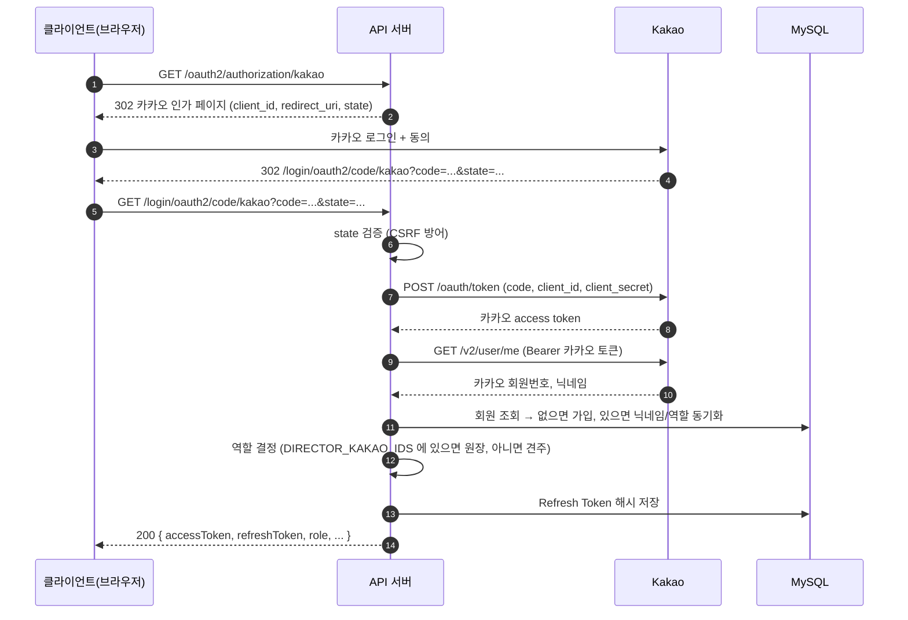
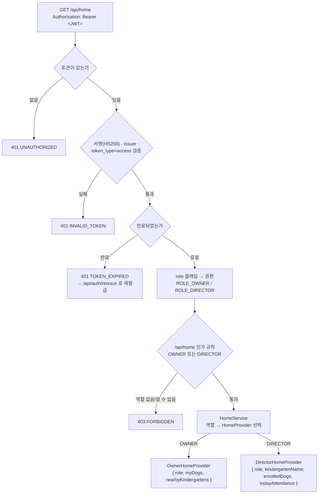

# puppy-kindergarten-api

반려견 유치원(견주 ↔ 원장 연결 플랫폼)의 인증/권한 API.

Kakao 소셜 로그인(OAuth 2.0) → 자체 JWT 발급/검증 → 역할(견주/원장) 기반 홈 분기.

- [1. 전체 흐름](#1-전체-흐름)
- [2. 기술 스택과 선택 근거](#2-기술-스택과-선택-근거)
- [3. 실행 방법](#3-실행-방법)
- [4. 환경변수](#4-환경변수)
- [5. API 명세](#5-api-명세)
- [6. 인증/권한 정책](#6-인증권한-정책)
- [7. 테스트와 검증](#7-테스트와-검증)
- [8. Git 전략](#8-git-전략)
- [9. LLM 활용 내역](#9-llm-활용-내역)

---

## 1. 전체 흐름

### 1-1. 로그인 → JWT 발급



### 1-2. JWT 검증 → 권한 검증 → 역할 분기



### 1-3. 패키지 구조

```
com.puppykindergarten
├── auth
│   ├── oauth    카카오 OAuth2 로그인 (사용자 조회, 성공/실패 핸들러)
│   ├── jwt      자체 JWT 발급/검증
│   ├── token    Refresh Token 저장, 재발급, 로그아웃, 만료 정리
│   ├── AuthController      POST /api/auth/reissue, /api/auth/logout
│   ├── AuthProperties      원장 지정 목록, 역할 결정 기준
│   └── KakaoLoginService   가입/로그인 처리
├── home         역할별 홈 (HomeProvider 구현체 2개)
├── user         User, Role, 내 정보 API
└── config       SecurityConfig, 에러 응답 형식
```

---

## 2. 기술 스택과 선택 근거

| 구분 | 사용 | 버전 |
|---|---|---|
| 언어 | Java | 17 (Gradle toolchain 고정) |
| 프레임워크 | Spring Boot | 3.3.13 |
| 보안 | Spring Security (OAuth2 Client + Resource Server) | 6.3.x (Boot 관리 버전) |
| 빌드 | Gradle (wrapper) | 8.14.3 |
| DB | MySQL + Spring Data JPA | 8.0 |
| JWT | nimbus-jose-jwt | Resource Server 포함 버전 |
| 테스트 | JUnit 5, MockMvc, H2(MySQL 호환 모드) | |

**카카오 로그인: Spring Security OAuth2 Client**
인가 요청 생성, `state` 검증, 토큰 교환, 사용자 정보 조회를 직접 구현하지 않고 검증된 구현(`oauth2Login`)에 맡겼다. 직접 작성한 부분은 카카오 사용자를 우리 회원으로 연결하는 `KakaoOAuth2UserService` 와 성공/실패 핸들러뿐이다. 카카오는 표준 OIDC 공급자 목록에 없어 `application.yml` 에 provider 정보를 등록했고, 클라이언트 인증은 카카오 요구에 맞춰 `client_secret_post` 를 쓴다.

**JWT 검증: Spring Security Resource Server**
Bearer 토큰 추출, 서명·만료 검증, 인증 객체 생성까지 필터를 직접 만들지 않고 `oauth2ResourceServer().jwt()` 를 사용했다. 커스텀 필터에서 흔히 생기는 실수(예외 처리 누락, 필터 순서 오류)를 줄일 수 있다.

**JWT 라이브러리: nimbus-jose-jwt**
Resource Server 스타터에 이미 포함돼 있어, 발급(`NimbusJwtEncoder`)과 검증(`NimbusJwtDecoder`)을 추가 의존성 없이 한 라이브러리로 통일했다. jjwt 를 따로 넣으면 발급과 검증이 서로 다른 라이브러리를 거치게 된다.

**서명 알고리즘: HS256**
토큰을 발급하는 서버와 검증하는 서버가 같은 단일 서비스라 대칭키로 충분하다. 검증 주체가 여럿으로 나뉘면 RS256(공개키 배포)으로 바꾸는 것이 맞다.

**Refresh Token: JWT + DB 저장(해시)**
Refresh Token 도 JWT 로 발급해 서명·만료를 먼저 검증하고, DB 에는 SHA-256 해시만 저장해 재발급·로그아웃 때 대조한다. DB 가 유출돼도 저장된 값으로는 재발급을 요청할 수 없다. 토큰 자체가 서명된 고엔트로피 값이라 솔트·스트레칭 없이 SHA-256 으로 충분하다.

**역할 분기: 역할별 `HomeProvider` 구현체**
컨트롤러·서비스에 `if (role == ...)` 를 두지 않고, 역할 하나당 구현체 하나를 두어 `HomeService` 가 역할 → 구현체 매핑으로 고른다. 역할이 추가되면 구현체만 추가하면 되고, 구현을 빠뜨리면 애플리케이션이 기동되지 않는다.

**테스트 DB: H2(MySQL 호환 모드)**
외부 DB 없이 `./gradlew test` 만으로 전체 테스트가 돈다. 운영 설정(`application.yml`)은 그대로 쓰고 테스트 전용 값만 덮어쓴다.

---

## 3. 실행 방법

### 사전 준비

- JDK 17 (다른 버전이 기본이어도 Gradle toolchain 이 17 을 찾아 사용)
- Docker (MySQL 8.0 컨테이너)
- 카카오 개발자 콘솔([developers.kakao.com](https://developers.kakao.com)) 애플리케이션

### 카카오 애플리케이션 설정

1. 애플리케이션 추가 → **앱 키 > REST API 키** 확인 (`KAKAO_CLIENT_ID`)
2. **카카오 로그인** 활성화
3. **Redirect URI** 등록: `http://localhost:8080/login/oauth2/code/kakao`
4. **보안 > Client Secret** 발급, 사용함으로 설정 (`KAKAO_CLIENT_SECRET`)
5. **동의항목**: 닉네임(`profile_nickname`) 설정

### 실행

```bash
# 1. 환경변수 파일 준비
cp .env.example .env
#    .env 를 열어 값을 채운다. JWT_SECRET 은 아래 명령으로 생성한다.
openssl rand -base64 32

# 2. MySQL 실행
docker compose up -d

# 3. 애플리케이션 실행 (프로젝트 루트의 .env 를 자동으로 읽는다)
./gradlew bootRun
```

### 동작 확인

1. 브라우저에서 `http://localhost:8080/oauth2/authorization/kakao` 접속 → 카카오 로그인
2. 응답 JSON 의 `accessToken` 복사
3. 홈 호출

```bash
curl -H "Authorization: Bearer <accessToken>" http://localhost:8080/api/home
```

### 원장 계정으로 확인하기

역할은 사용자가 고를 수 없고, 서버에 사전 지정한 카카오 회원번호만 원장이 된다.

1. 먼저 견주로 로그인한 뒤 내 정보에서 `kakaoId` 를 확인한다.

```bash
curl -H "Authorization: Bearer <accessToken>" http://localhost:8080/api/users/me
# { "userId": 1, "kakaoId": 1234567890, "nickname": "...", "role": "OWNER" }
```

2. `.env` 에 `DIRECTOR_KAKAO_IDS=1234567890` 을 넣고 애플리케이션을 재시작한다.
3. 다시 카카오 로그인하면(또는 토큰을 재발급하면) `role` 이 `DIRECTOR` 인 토큰이 발급되고, 같은 `/api/home` 이 원장 응답을 준다.

### 테스트

```bash
./gradlew test
```

MySQL·카카오 없이 실행된다(H2, 가짜 카카오 서버 사용).

---

## 4. 환경변수

시크릿은 코드와 설정 파일에 두지 않고 환경변수로만 주입한다. `.env` 는 `.gitignore` 대상이며 저장소에는 [.env.example](.env.example) 만 있다.

| 이름 | 필수 | 기본값 | 설명 |
|---|---|---|---|
| `DB_USERNAME` | O | | MySQL 사용자 |
| `DB_PASSWORD` | O | | MySQL 비밀번호 |
| `DB_ROOT_PASSWORD` | O (docker-compose) | | MySQL root 비밀번호 |
| `DB_HOST` | | `localhost` | MySQL 호스트 |
| `DB_PORT` | | `3306` | MySQL 포트 |
| `DB_NAME` | | `puppy_kindergarten` | 데이터베이스 이름 |
| `KAKAO_CLIENT_ID` | O | | 카카오 REST API 키 |
| `KAKAO_CLIENT_SECRET` | O | | 카카오 Client Secret |
| `JWT_SECRET` | O | | HS256 서명키. Base64 인코딩, 디코딩 기준 32바이트 이상 |
| `JWT_ISSUER` | | `puppy-kindergarten-api` | `iss` 클레임 |
| `JWT_ACCESS_TTL` | | `15m` | Access Token 유효 시간 |
| `JWT_REFRESH_TTL` | | `14d` | Refresh Token 유효 시간 |
| `DIRECTOR_KAKAO_IDS` | | (비어 있음) | 원장으로 지정할 카카오 회원번호. 쉼표 구분 |
| `JPA_DDL_AUTO` | | `update` | 스키마 자동 생성 방식 |
| `SERVER_PORT` | | `8080` | 서버 포트 |

필수 값이 없으면 애플리케이션이 기동되지 않는다. `JWT_SECRET` 은 형식이 틀리거나 32바이트보다 짧아도 기동에 실패한다.

---

## 5. API 명세

### 요약

| 메서드 | 경로 | 인증 | 설명 |
|---|---|---|---|
| GET | `/oauth2/authorization/kakao` | 없음 | 카카오 로그인 시작 (카카오로 리다이렉트) |
| GET | `/login/oauth2/code/kakao` | 없음 | 카카오 콜백. 가입/로그인 처리 후 JWT 발급 |
| POST | `/api/auth/reissue` | Refresh Token | Access/Refresh Token 재발급 |
| POST | `/api/auth/logout` | Refresh Token | 로그아웃 (Refresh Token 폐기) |
| GET | `/api/users/me` | Bearer | 내 정보 |
| GET | `/api/home` | Bearer (OWNER, DIRECTOR) | 역할별 홈 |

### 로그인 콜백 응답 — `GET /login/oauth2/code/kakao`

```json
{
  "tokenType": "Bearer",
  "accessToken": "eyJhbGciOiJIUzI1NiJ9...",
  "accessTokenExpiresIn": 900,
  "refreshToken": "eyJhbGciOiJIUzI1NiJ9...",
  "userId": 1,
  "nickname": "초코아빠",
  "role": "OWNER"
}
```

프론트엔드가 없는 과제 범위라 토큰을 콜백 응답 본문으로 내려준다. 응답에는 `Cache-Control: no-store` 가 붙는다.

### 재발급 — `POST /api/auth/reissue`

요청
```json
{ "refreshToken": "eyJhbGciOiJIUzI1NiJ9..." }
```
응답 200
```json
{
  "tokenType": "Bearer",
  "accessToken": "...",
  "accessTokenExpiresIn": 900,
  "refreshToken": "..."
}
```

### 로그아웃 — `POST /api/auth/logout`

요청
```json
{ "refreshToken": "eyJhbGciOiJIUzI1NiJ9..." }
```
응답 204 (본문 없음)

### 내 정보 — `GET /api/users/me`

```json
{ "userId": 1, "kakaoId": 1234567890, "nickname": "초코아빠", "role": "OWNER" }
```

### 홈 — `GET /api/home`

같은 API 가 JWT 의 `role` 에 따라 다른 응답을 준다. 데이터는 더미다.

견주 (`role=OWNER`)
```json
{
  "role": "OWNER",
  "myDogs": [
    { "id": 1, "name": "초코", "breed": "푸들", "age": 3 },
    { "id": 2, "name": "보리", "breed": "말티즈", "age": 5 }
  ],
  "nearbyKindergartens": [
    { "id": 10, "name": "해피퍼피 유치원", "address": "서울 마포구 연남로 12", "distanceKm": 0.8 }
  ]
}
```

원장 (`role=DIRECTOR`)
```json
{
  "role": "DIRECTOR",
  "kindergartenName": "해피퍼피 유치원",
  "enrolledDogs": [
    { "id": 1, "name": "초코", "breed": "푸들", "ownerName": "김견주", "attendedToday": true }
  ],
  "todayAttendance": 5
}
```

### 에러 응답

모든 에러는 같은 형식이다.

```json
{ "code": "TOKEN_EXPIRED", "message": "토큰이 만료되었습니다." }
```

| HTTP | code | 상황 |
|---|---|---|
| 400 | `INVALID_REQUEST` | 요청 본문이 없거나 형식이 틀림 |
| 401 | `UNAUTHORIZED` | 토큰 없이 보호된 API 호출 |
| 401 | `TOKEN_EXPIRED` | Access Token 만료 → 재발급 필요 |
| 401 | `INVALID_TOKEN` | 위조, 형식 오류, Refresh Token 을 Bearer 로 사용 등 |
| 401 | `INVALID_REFRESH_TOKEN` | Refresh Token 이 위조·만료·이미 사용됨·로그아웃됨 |
| 401 | `KAKAO_LOGIN_FAILED` | 카카오 로그인 실패 (취소, state 불일치, 코드 거부 등) |
| 403 | `FORBIDDEN` | 역할이 없거나 권한 부족 |
| 404 | `NOT_FOUND` | 토큰은 유효하지만 회원이 없음 |

---

## 6. 인증/권한 정책

### JWT

| | Access Token | Refresh Token |
|---|---|---|
| 유효 시간(기본) | 15분 | 14일 |
| 클레임 | `sub`(사용자 ID), `role`, `token_type=access`, `iss`, `iat`, `exp`, `jti` | `sub`, `token_type=refresh`, `iss`, `iat`, `exp`, `jti` |
| 서버 저장 | 저장 안 함 | SHA-256 해시만 MySQL 에 저장 |
| 용도 | API 인증 (`Authorization: Bearer`) | 재발급, 로그아웃 |

- 알고리즘은 HS256 으로 고정한다(`alg=none` 이나 다른 알고리즘의 토큰 거부).
- `token_type` 으로 두 토큰을 구분해, Refresh Token 을 API 인증에 쓰거나 Access Token 으로 재발급받을 수 없다.
- 만료 검증에 허용 오차를 두지 않는다. 만료 시각이 지나면 바로 거부한다.

### 역할 부여

- 최초 로그인 시 `ROLE_OWNER`(견주)로 가입한다.
- `ROLE_DIRECTOR`(원장)는 사용자가 선택할 수 없고, 서버 환경변수 `DIRECTOR_KAKAO_IDS` 에 사전 지정한 카카오 회원번호에만 부여한다.
- 역할은 **로그인할 때와 토큰을 재발급할 때마다** 이 목록 기준으로 다시 계산해 DB 와 토큰에 반영한다.

### 재발급

- 재발급은 교체다. 사용한 Refresh Token 은 즉시 폐기하고 새 Access/Refresh 쌍을 발급한다(1회용).
- 폐기는 단일 `DELETE` 의 삭제 행 수로 판정한다. 같은 토큰으로 요청이 동시에 와도 한 요청만 성공하고 나머지는 401 이다.
- 이미 사용했거나 로그아웃한 토큰이 다시 제시되면 그 요청만 401 로 거부한다. 다른 기기의 토큰은 유지된다.
- Access Token 이 만료된 뒤 호출하는 API 이므로 Access Token 을 요구하지 않으며, 요청에 Authorization 헤더가 붙어 있어도 읽지 않는다.

### 로그아웃

- 제시한 Refresh Token 을 폐기한다. 이후 그 토큰으로는 재발급할 수 없다.
- **이미 발급된 Access Token 은 만료 시각(기본 15분)까지 유효하다.** 서버가 Access Token 을 저장하지 않으므로 즉시 차단하지 않는다. 즉 로그아웃 후에도 최대 15분 동안은 기존 Access Token 으로 API 를 호출할 수 있다.
- 로그아웃은 해당 기기의 토큰만 폐기한다. 같은 사용자의 다른 기기는 로그인 상태가 유지된다.
- 이미 폐기된 토큰으로 다시 호출해도 204 를 응답한다(멱등).

### 역할 변경의 반영 시점

- `/api/home` 은 DB 가 아니라 **JWT 의 `role` 클레임**으로 분기한다.
- 따라서 역할이 바뀌어도(원장 목록에서 추가/제외) 이미 발급된 Access Token 은 만료될 때까지 이전 역할로 동작한다. 다음 재발급 또는 로그인부터 새 역할이 반영된다(최대 15분).

### 그 외

- 인증 상태는 서버 세션에 저장하지 않는다(`STATELESS`). 카카오 로그인 중 `state` 보관에만 잠깐 쓰인 세션은 로그인 성공 시 폐기한다.
- 만료된 Refresh Token 기록은 매일 새벽 4시에 정리한다.
- 로그인 실패 원인, Refresh Token 이 거부된 구체적 이유는 응답에 드러내지 않고 로그에만 남긴다.

---

## 7. 테스트와 검증

`./gradlew test` — 59개.

| 테스트 클래스 | 수 | 검증 내용 |
|---|---|---|
| `KakaoLoginFlowTest` | 11 | 인가 요청 리다이렉트부터 콜백, 가입, JWT 발급, 역할별 홈까지 전체 흐름 |
| `KakaoLoginServiceTest` | 4 | 최초 가입, 중복 가입 방지, 원장 지정, 역할 동기화 |
| `JwtTokenProviderTest` | 12 | 클레임, 만료, 위조, 변조, `alg=none`, 토큰 종류 교차 사용, 약한 키 |
| `BearerAuthenticationTest` | 7 | Bearer 검증과 401 코드 구분 |
| `TokenReissueLogoutTest` | 16 | 재발급 교체, 1회용, 동시 요청, 역할 재계산, 로그아웃 정책 |
| `HomeApiTest` | 8 | 역할별 응답, 권한 검증(401/403/404) |
| `PuppyKindergartenApplicationTests` | 1 | 애플리케이션 컨텍스트 기동 |

**카카오 연동 테스트 방식**
실제 카카오를 호출하지 않고, 테스트 안에서 카카오의 토큰·사용자 정보 엔드포인트를 흉내 내는 가짜 서버(`FakeKakaoServer`)를 띄워 시큐리티 필터 체인 전체를 통과시킨다. 서버가 카카오에 보내는 요청(인가 코드, `client_secret_post`, Bearer 헤더)까지 확인한다.

**보안 관점에서 확인한 항목**

- `state` 가 일치하지 않거나 로그인을 시작한 적 없는 콜백은 거부하고, 카카오 토큰 요청도 보내지 않는다.
- 인가 리다이렉트 URL 에 Client Secret 이 노출되지 않는다.
- 다른 키로 서명한 토큰, 페이로드를 변조한 토큰(견주 → 원장 바꿔치기), 서명 없는 토큰을 거부한다.
- 쿼리 파라미터나 헤더로 역할을 바꿀 수 없다.
- 견주 응답에 원장 전용 필드가, 원장 응답에 견주 전용 필드가 섞여 나가지 않는다.
- 로그인 후에도 세션 쿠키만으로는 보호된 API 에 접근할 수 없다.
- Refresh Token 은 원문이 아니라 해시로만 저장된다.

---

## 8. Git 전략

```
main ← epic/auth ← feature/*
```

- `main` 에는 직접 push 하지 않고 `epic/auth` 를 거친 PR 로만 반영한다.
- 기능 단위로 `feature/*` 브랜치를 만들어 `epic/auth` 로 PR 을 보낸다.
- 커밋 메시지는 `feat:`, `fix:`, `docs:`, `chore:` 접두사를 쓴다.

| PR | 브랜치 | 내용 |
|---|---|---|
| #1 | `feature/project-setup` | Spring Boot 3.3 + Gradle 8 뼈대, MySQL docker-compose, 환경변수 구조 |
| #2 | `feature/kakao-login` | 카카오 OAuth2 로그인, 최초 로그인 시 가입, 역할 부여 |
| #3 | `feature/jwt` | 자체 JWT 발급, Bearer 검증 |
| #4 | `feature/token-reissue-logout` | 재발급(교체), 로그아웃(폐기) |
| #5 | `feature/role-home` | 역할 기반 홈 API |
| #6 | `feature/docs` | 문서 |

---

## 9. LLM 활용 내역

Claude Code(Anthropic)를 설계, 구현, 테스트, 코드 리뷰, 문서 작성에 사용했다.

### 작업별 활용

| 작업 | 어떻게 썼는가 | 어떻게 검증했는가 |
|---|---|---|
| 설계 | 과제 요구사항을 주고 진행 순서, PR 분할, 설계 선택지를 제안받았다. | 선택지마다 근거를 확인하고 직접 결정했다. 역할 부여 방식은 제안(가입 후 역할 선택 API)을 채택하지 않고 "서버에서 사전 지정" 으로 바꿨고, 로그아웃 정책(Refresh 폐기, Access 는 만료까지 유효)도 직접 정했다. |
| 구현 | 기능 단위로 코드 작성을 맡겼다. | 변경마다 전체 자동 테스트를 실행해 통과를 확인한 뒤 머지했다. 재발급·로그아웃(PR #4)은 변경 내용을 직접 읽고 정책을 다시 확정했다. |
| 테스트 | 정상 흐름과 함께 공격·오류 상황(위조 토큰, state 불일치, 동시 요청 등)의 테스트 작성을 맡겼다. | `./gradlew test` 를 매 변경마다 실행했다. 테스트 이름을 정책 문장으로 써서, 정책과 테스트가 일치하는지 읽어서 확인할 수 있게 했다. |
| 코드 리뷰 | 구현이 끝난 PR 에 LLM 코드 리뷰를 다시 돌렸다. | 나온 항목을 그대로 반영하지 않고 과제 요구사항 기준으로 반영 여부를 판단했다(아래 참고). |
| 문서 | README 초안 작성을 맡겼다. | 코드와 테스트 실행 결과를 기준으로 작성하게 하고, 정책 설명이 실제 동작(테스트)과 일치하는지 대조했다. |

### LLM 결과를 그대로 쓰지 않은 사례

- **Refresh Token 재사용 감지 제거**: LLM 이 요청하지 않은 기능으로 "폐기된 Refresh Token 이 다시 제시되면 그 사용자의 모든 토큰을 폐기" 를 넣었다. 리뷰에서 네트워크 재시도나 로그아웃 직후의 자동 재발급만으로 다른 기기까지 로그아웃되는 부작용이 드러나 제거하고, "첫 요청 성공 / 이후 요청 401 / 다른 기기 유지" 로 정책을 확정했다.
- **만료된 Bearer 헤더 문제**: 재발급 API 가 "인증 불필요" 로 설정돼 있었지만, 요청에 만료된 Access Token 이 붙어 있으면 필터가 먼저 401 로 거부했다. 테스트가 헤더 없는 경우만 다뤄 통과하고 있었고, 리뷰에서 발견해 수정과 테스트를 추가했다.
- **역할 재계산 누락**: 재발급이 DB 에 저장된 역할을 그대로 다시 담아, 원장 목록에서 제외된 사용자가 재발급만 반복하면 원장 권한을 계속 유지할 수 있었다. 재발급 때도 역할을 다시 계산하도록 고쳤다.
- **만료 허용 오차**: Spring Security 기본값인 60초 허용 오차가 적용돼, 응답으로 안내한 만료 시간(900초)과 실제 동작이 달랐다. 허용 오차를 0 으로 맞췄다.
- **리뷰 항목의 선별 반영**: 두 차례 리뷰에서 나온 19건 중 15건을 반영했다. 나머지는 더미 데이터 범위이거나 의도된 동작(역할 변경은 Access Token 만료 후 반영)이라 반영하지 않고 이 문서에 정책으로 적었다.

### 한계

- 카카오 연동의 자동 테스트는 가짜 서버를 상대로 한 것이다. 실제 카카오 환경의 설정(Redirect URI, 동의항목, Client Secret 사용 여부)은 [3. 실행 방법](#3-실행-방법)의 절차로 직접 확인해야 한다.
